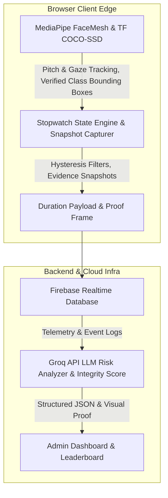

# AeroSoc BIT Mesra Proctored Testing Platform

**Author and Credits:** Anurag Kumar Verma

## 1. Purpose

The platform is built specifically for AeroSoc BIT Mesra's Recruitment Online Assessment. It addresses the need for a scalable, privacy-first testing environment that prevents cheating without using intrusive, instant-lockout mechanics. By employing an observe-and-log duration-based model, it ensures a seamless experience for candidates and zero media storage, while giving administrators concrete data on academic integrity.

## 2. Architecture Overview

**Core Framework:** Next.js 16 (App Router).

**Authentication and State:** Firebase Realtime Database and Admin SDK. (Note: Firestore is not used in order to avoid document write limits).

**Edge Proctoring Engine:** MediaPipe (FaceMesh for face presence, TF COCO-SSD for verified device detection). All processing executes client-side to minimize infrastructure costs.

**Data Flow:** Local stopwatch logging computes the exact duration of an infraction (e.g., out of fullscreen, verified device detected) and sends debounced writes to Firebase Realtime Database with lightweight evidence frames.

**Integrity & AI Analytics:** An objective mathematical Integrity Index (0–100%) combined with Groq API LLM risk evaluation produces human-readable, auditable proctoring summaries with snapshot proof for administrators.

### Architecture Flowchart

## 3. High-Concurrency Resilience and Scalability

The platform is engineered specifically to handle the Thundering Herd scenario, where 500 or more users click "Start Test" at the exact same millisecond. Traditional architectures fail under this stress due to database connection limits and strict API rate limiting. This platform guarantees stability for 500+ concurrent users processing 100+ MCQs through a four-pillar distributed architecture.

### 3.1 Overcoming Firebase Realtime Database Limitations

**The Workaround:** 
1. **Zero-Connection Exam State:** The system strictly prohibits the client application from maintaining an open WebSocket connection to Firebase during the examination.
2. **Offline-Resilient Persistence:** A custom `useTestState` hook tightly couples the React application state to the browser's `localStorage`. Every time a student selects one of the 100+ MCQs, the answer is synchronously updated on their local machine. This results in exactly zero database writes during the exam phase.

### 3.2 Overcoming Vercel and Database Read Bottlenecks

**Edge-Cached Question Delivery:** Questions are relayed through a serverless route (`/api/get-test-questions`) rather than direct client-to-database calls. This route is configured with aggressive `Cache-Control` headers. When the first user requests the test, Vercel fetches the payload from Firebase and caches it globally across its Edge Network. The database experiences zero additional reads, neutralizing the traffic spike completely.

### 3.3 Overcoming Submission Bottlenecks

**Secure Serverless Relay with Isolated Writes:** The final JSON payload is dispatched to a secure Vercel API route (`/api/grade-test`). Each function validates the Firebase Auth ID token server-side and then executes a write to a mathematically isolated path (`submissions/{testId}/{uid}`) using the Firebase Admin SDK. Because the write paths are entirely isolated, there is zero database contention. 

### 3.4 Scalability of Concurrent Proctoring Logs

When closing infractions, the system uses the RTDB `push()` method (`push(ref(rtdb, flagPath()), flag)`). Firebase push IDs are mathematically guaranteed to be unique and chronologically sortable based on time, meaning thousands of candidates can write concurrently to the same `/flags` path without locking the database or overwriting each other.

Furthermore, massive MediaPipe FaceMesh WASM binary and model assets are not bundled locally but fetched dynamically via the global `jsdelivr.net` CDN at runtime to keep initial payload sizes small.

## 4. Computer Vision & Frame Pipeline Optimization

- **Memory Leak and WebGL Context Loss Prevention:** The pipeline throttles AI inference to approximately 12 FPS by strictly enforcing a time delta (`now - lastFrameTime >= 83` ms) inside the `requestAnimationFrame` loop. It utilizes a `processing` boolean flag lock to prevent overlapping async inference calls. If MediaPipe throws an error, the `try-catch` block catches and suppresses it, keeping the React lifecycle alive.
- **Verified Device Detection without False Positives:** Phone detection relies strictly on verified deep learning models (COCO-SSD with MobileNet v2) using high confidence thresholds ($\ge 0.52$). Heuristic edge/rectangle detectors that falsely trigger on window frames, posters, and books have been eliminated.
- **Low-Tier Hardware Optimization:** On mobile platforms or hardware with low concurrency ($\le 4$ cores), heavy background models are skipped or lightweight backends (WASM/CPU) are gracefully initialized to prevent device freezing and battery drain.

## 5. Telemetry & State Synchronization

- **Tab Closure Protection:** A `flushInfractions` function is bound to the `beforeunload` event. It calculates the duration of active infractions from `startTime` to `Date.now()`, filters out brief anomalies, and synchronously executes Firebase `push()` commands to ensure logs make it to the RTDB before the tab finishes closing.
- **Dual-Counter Hysteresis Filters:** Infractions are tracked using a hysteresis filter requiring **16 consecutive violating frames** to open an infraction and **18 consecutive clean frames** to clear it. Clean frames decay the violation counter, preventing micro-stutters from flooding the database.
- **Visual Evidence Snapshot:** For critical violations (`MULTIPLE_FACES`, `PHONE_DETECTED`, `CAMERA_COVERED`), an ultra-lightweight client-side thumbnail ($320 \times 240$ JPEG, $\sim 8\text{ KB}$) is generated and attached to the flag. Evaluators can review this visual proof in the admin console.

## 6. Security and Integrity Mechanisms

The system enforces a strict defense-in-depth security perimeter:

- **Firebase Rules RBAC:** The `.validate` rule on the database strictly ensures that `Question Setters` can only edit and submit keys for records where `newData.child('authorEmail').val() == auth.token.email`.
- **Client-Side DOM Restrictions:** Rigorous DOM restrictions disable text selection, drag-to-copy, and context menus. Keydown listeners block keyboard shortcuts (Ctrl/Cmd + C, A, S, P, U), and `window.print` is actively overridden to defeat PDF exports.
- **Penalty HUD & DevTools Mitigation:** Getting to DevTools typically requires exiting fullscreen or unfocusing the window. Doing so triggers a `LEFT_FULLSCREEN` or `TAB_SWITCHED` infraction, logging a hard violation, deducting a Life, and putting the user in a 5-second mandatory blurred Penalty Box.
- **Time Tampering Defenses:** If an examinee tampers with the local clock to gain extra time, server-side timestamp validation during submission catches the drift, permanently stamping the submission with a `DELAYED_SUBMISSION` flag.

## 7. AI Risk Analysis & Objective Integrity Scoring

- **Mathematical Integrity Index:** The platform computes an objective score from 0% to 100% based on categorized infractions:
  - **Hard Violations** (Tab Switch, Fullscreen Exit, Multiple Faces, Unauthorized Device, Camera Obstructed): High point deductions.
  - **Soft Telemetry** (Gaze deviations, Natural head pitch while reading, Room noise): Gradual duration-based weighting ($1\text{ pt}$ per $20\text{ seconds}$ of cumulative deviation, max $25\text{ pts}$).
  - **Trust Ratings:** $\ge 85\%$ (High Trust), $65\%\text{--}84\%$ (Review Suggested), $< 65\%$ (Flagged).
- **Categorized Groq LLM Ingestion:** The Groq API receives separate summaries of hard violations vs soft physiological movements along with the calculated Integrity Score. This ensures fair, balanced proctoring summaries rather than blanket disqualifications.
- **Fallback & Rate Limits:** Rate limit errors (429) cleanly bubble to the admin UI with retry countdowns. If JSON parsing fails, the system safely falls back to standard calculated integrity metrics.

## 8. Role-Based Access Control and Security Architecture

The platform features a multi-tiered Role-Based Access Control (RBAC) system for delegating and auditing examination responsibilities securely.

### 8.1 Role Hierarchy

- **Admin Sr. (Supreme Administrators):** Root administrators (`NEXT_PUBLIC_ADMIN_1`, `NEXT_PUBLIC_ADMIN_2`) holding complete authority over test setups, candidate enrollments, personnel approvals, results declaration, and system calibration. All actions taken by supreme admins are explicitly stamped as **Admin Sr.** in the system audit logs.
- **Admin L1 (Supervisory & Audit Administrator):** A specialized supervisory and auditing role designed for club leadership and senior monitors. Admin L1 users have access to:
  1. **Organized Events View:** Real-time chronological audit trail of all actions performed by Question Setters and Admin Sr. (question additions/edits/deletions, section updates, personnel actions). Includes role filters, category filters, and preview details.
  2. **Test Structure & Question Attribution:** Full inspection of tests and sections, with an explicit attribution badge under every question indicating who created it, their role, and timestamps. Strictly read-only to prevent unauthorized alterations.
  3. **Live Leaderboard & Candidate Evaluation:** Full access to examination results with live leaderboard rankings, Interviewer Mode (filtering Qualified and Waitlisted candidates), search filtering, and Excel export (`.xlsx`).
  4. **On-Demand AI Integrity Review:** Direct access to trigger and re-run on-demand Groq AI reviews on candidates' proctoring telemetry. Persisted securely via the server-side Firebase Admin SDK.
  5. **Candidate Round Status Management:** Authority to advance or adjust candidate admission statuses across **Pending**, **Qualified**, **Eliminated**, and **Waitlisted** via the dedicated, authenticated `/api/update-round-status` server endpoint.
  6. **Participants Directory (Read-Only):** Secure inspection of registered candidate rosters and examination enrollments without modification privileges.
- **Question Setter:** Authorized club personnel permitted to create exam sections, upload and edit questions with unique 9-character alphanumeric tags (`#123ABCXYZ`), and submit solutions once tests conclude. Database rules enforce author-only modifications.
- **Spectator's View:** Dedicated evaluation role for interviewers to view declared candidate rankings, AI integrity summaries, flagged incidents, and evidence snapshots.

### 8.2 Activity Audit & Events Logging Engine

- **Comprehensive Telemetry:** An automated audit logger (`auditLogger.ts`) records all state-changing administrative actions to Firebase Realtime Database (`audit_logs`).
- **Logged Events:** Question additions, question edits, question deletions, section creations, section updates, section deletions, test creations/deletions, solution submissions, personnel approvals/rejections/revocations, participant enrollments (single & CSV bulk import), and participant removals.
- **Rich Metadata:** Every event logs the actor's email, name, role badge, timestamp (relative & ISO), target examination, section, question tag, participant identifiers, and preview snippet.
- **Global Log Management:** Supreme administrators (**Admin Sr.**) hold full log governance with individual entry review and deletion authority via `/admin/logs`, protected by RTDB security rules.
- **Dual-Surface Visibility:** The interactive Events View component (`EventsAuditView.tsx`) is accessible to **Admin L1** in their dedicated dashboard (`/admin-l1`) and to **Admin Sr.** inside the dedicated Global Audit Logs page (`/admin/logs`) and Personnel Management console.

### 8.3 Personnel Request & Verification Flow

Users authenticate via Google Auth and submit applications via the **"Seek Permission: Club Personnel Only"** portal selecting their requested role (`Question Setter`, `Spectator's View`, or `Admin L1`). Supreme Admins review and approve/reject applications within the Personnel Management console.

### 8.4 Team Coordination Corner (TCC) Com & Direct Log Dispute System

The platform includes a dedicated, unified communication ecosystem—the **Team Coordination Corner (TCC)**—connecting **Admin Sr.**, **Admin L1**, and **Question Setters**.

- **Session-Based Collaboration:** Any approved personnel can initiate coordination sessions for question drafting, exam guidelines, technical issues, or moderation.
- **Strict 50-Session Archival Cap:** To maintain peak database performance and streamline communications, each personnel maintains strictly their **past 50 conversation sessions** (`tcc_user_sessions/{encodedEmail}`). The system automatically prunes older sessions beyond this limit upon new activity.
- **Direct Log Dispute Authority:**
  - **Authorized Roles:** **Admin Sr.** and **Admin L1** hold dedicated dispute authority embedded directly into the Activity Audit View (`EventsAuditView.tsx`).
  - **Automatic Initiator Ping & Default Inclusion:** When raising a dispute on any audit log entry, the initiator of that action is automatically extracted, badged, and involved by default, triggering an immediate high-priority ping notification.
  - **Dynamic Party Selection:** The dispute raiser can dynamically select which additional personnel (Admin Sr., Admin L1s, Question Setters) need to be included in the room.
  - **Audit Tracking & Formal Resolution:** Disputes record priority (`Normal`, `High`, `Urgent`), grounds for dispute, and reference the disputed log entry. The raiser or Admin Sr. can conclude disputes with formal resolution notes stamped directly into the session timeline.
- **Real-Time Notification & In-App Pings:** Real-time listeners (`tcc_notifications`) alert personnel immediately when they are pinged in a dispute, invited to a session, or tagged in chat.
- **Smart @Mention & Universal Citizen Tagging:**
  - **Cross-Platform Member Discovery:** Typing `@` or clicking tag chips surfaces all approved personnel across the entire platform (Admin Sr., Admin L1, Question Setters), not just existing room members.
  - **Automatic Session Onboarding & History Sync:** Tagging an outside citizen automatically joins them into the session, indexes the conversation in their personal 50-session archive, posts a system onboarding notice, and delivers an instant high-priority ping so they immediately receive full message history.
  - **Manual Member Management:** Room drawer features a `+ Add Personnel` action to directly invite platform members without requiring a tag.
- **Transparency, Read Receipts & Presence Tracking:**
  - **Per-Message Read Receipts:** Messages track participant read status in real-time, showing single checkmark (`✓ Sent`) and double green checkmarks (`✓✓ Read by [Name]`) with hover tooltips detailing who read each message.
  - **Live Room Presence:** The participants drawer shows real-time activity (`● Active now`, `Seen [time]`, or `Unseen`) based on atomic `lastReadTimestamp` synchronization.
  - **Interactive Message Reactions:** Members can toggle one-tap emoji reactions (`👍`, `✅`, `👀`, `⚠️`) on any message with real-time actor attribution.
- **Omnipresent Access:** Accessible directly via `/tcc`, with embedded tabs and quick shortcuts in the Admin Sr. console (`/admin`), Admin L1 dashboard (`/admin-l1`), Question Setter portal (`/question-setter`), and Global Audit Logs (`/admin/logs`).

### 8.5 Candidate Enrollment & Adaptive Roster Ingestion

The **Participant Management** console (`/admin/participants`) provides granular control over candidate access and test assignment.

- **Dual Ingestion Interfaces:**
  - **Manual Input:** Fast entry for single or multiple students formatted as `Name, Email` or plain `Email` (one entry per line).
  - **Spreadsheet Bulk Import (`.xlsx`, `.csv`):** Upload candidate registries directly exported from Google Forms, Fillout, Microsoft Forms, or custom spreadsheets.
- **Headerless & Form-Export Auto-Detection:**
  - Standard spreadsheet parsers fail when sheets lack explicit column headers (`Name`, `Email`) or begin directly with candidate records on Row 1.
  - The ingestion engine inspects row 1 for `@` signatures. If headers are absent, it dynamically detects the email column and derives candidate names without requiring manual spreadsheet editing.
  - For sheets with headers, fuzzy matching automatically recognizes variations such as `email address`, `mail`, `student name`, `candidate name`, and `full name`.
  - In cases of non-standard column arrangements, per-row dynamic cell scanning extracts valid email addresses and falls back gracefully to email prefix usernames when names are omitted.
- **Per-Test Multi-Tenancy:** Candidates can be enrolled across multiple independent examinations simultaneously using RTDB indexed paths (`participants/{encodedEmail}/tests/{testId}`), allowing granular test-level revocation without deleting student master accounts.

### 8.6 Standardized Date & Time Engine and High-Visibility UI Specification

To eliminate ambiguity across locales and maximize readability on dark UI surfaces, all date and time displays throughout the platform adhere strictly to a standardized formatting and styling specification governed by `src/lib/dateUtils.ts`.

- **Strict Formatting Rules:**
  - **Numeric Format (`DD/MM/YYYY`):** Used in compact tables, desktop and mobile personnel registries, and telemetry lists (e.g., `27/10/2026`). Prevents ambiguous US `MM/DD/YYYY` interpretations.
  - **Ordinal Format (`DD(st/nd/rd/th) MONTH YEAR`):** Used in audit timelines, test scheduling banners, question attribution footers, dispute modals, and student waiting rooms (e.g., `27th October 2026` or `27th Oct 2026`).
  - **12-Hour Legible Time Format:** Formatted with padded two-digit hours, minutes, optional seconds, and clear meridian markers (`hh:mm AM/PM` / `hh:mm:ss AM/PM`).
- **High-Visibility & Legibility Styling Policy:**
  - **Pure White Contrast:** Date and time text everywhere renders in `#ffffff` (or `var(--white)`), eliminating hard-to-read muted gray (`--text-muted`) or dimmed (`--text-dim`) timestamps.
  - **Typography Enhancements:** Employs medium to bold weights (`500` / `600` / `700`), monospace tracking for numerical telemetry, and subtle text-shadowing (`text-shadow: 0 0 2px rgba(255,255,255,0.25)`) against high-density black backgrounds.
  - **Global CSS Utility Classes:** Enforced via `.timer`, `.datetime-text`, `.date-text`, `.time-text`, and `.timestamp-text` in `globals.css`.
- **System-Wide Coverage:**
  - **Global Audit Logs (`EventsAuditView.tsx`):** Ordinal dates with formatted time and subtle relative badges.
  - **Evaluation & Leaderboard (`LeaderboardTable.tsx`):** Telemetry flag timestamps (`DD/MM/YYYY, HH:MM:SS AM/PM`) and candidate interview schedules.
  - **Exam Control (`admin/control/page.tsx`):** Real-time formatted preview of auto-start schedules.
  - **Personnel Management (`admin/personnel/page.tsx`):** "Approved On" and "Applied On" candidate records across table and mobile card views.
  - **Question Setup & Admin L1 (`admin/setup`, `admin-l1`):** Question creation and last-edit attribution.
  - **Candidate Waiting Room (`waiting-room/page.tsx`):** Prominent ordinal start time banner for students.
  - **Dispute Resolution & TCC (`RaiseDisputeModal.tsx`, `TCCCom.tsx`):** Dispute event times, chat messages, activity heartbeats, and read timestamps.
  - **Candidate Dashboard (`student-dashboard/page.tsx`):** Interview appointment time slots.

### 8.7 Live Stats & Real-Time Examination Monitoring

The **Live Stats** engine delivers real-time, mission-critical operational telemetry for active examinations, accessible exclusively to **Admin Sr.**, **Admin L1**, and **Spectators**.

- **Scope & Gating:**
  - **Live Exam Gating:** Active only while an examination is marked `active` in `testState`. If no exam is live, the console gracefully renders an idle operational standby notice.
  - **Role-Based Protection:** Securely gated on the server via `/api/live-stats` using the Firebase Admin SDK (`getAdminAuth()`, `getAdminDb()`). Unauthorized accounts and regular test-takers receive an immediate `403 Forbidden` response.
- **Zero-Downtime Decoupled Architecture:**
  - **Untouched Candidate Runtime:** Does not alter candidate-side test runner bundles (`app/test/page.tsx`, `ProctoringMonitor.tsx`), guaranteeing that active test-takers face zero chunk invalidations, camera renegotiations, or page reloads mid-exam.
  - **Preserved Database Security Rules:** Operates with administrative service-account bypass privileges on the server, ensuring production `database.rules.json` remain untouched and student answer/flag writes suffer zero lock contention.
- **Real-Time Telemetry & Candidate Roster:**
  - **Live Metric HUD:** Displays real-time counts for Total Registered, In-Test (Currently Active), Submissions Completed, and Flagged Candidates.
  - **Candidate State Classification:** Tracks candidates dynamically across `[TAKING TEST]` (pulsing active status), `[SUBMITTED]` (completed answers received), and `[NOT STARTED]`.
  - **Heartbeat & Last Seen Tracker:** Computes exact relative time elapsed since the candidate's latest proctoring event or interaction (`Just now`, `12s ago`, `3m ago`).
  - **Live Infraction Counters:** Aggregates and badges severity distributions (`HIGH`, `MED`, `LOW`) with real-time incident descriptions.
- **Visual Evidence Inspection & Proof Drawer:**
  - Evaluators can click `INSPECT` or `PROOFS` on any candidate card to inspect full infraction timelines.
  - Features captured high-resolution camera proof frames with timestamps, violation durations, AI device detection metadata, and full-screen preview with offline download capability.
- **Mission Control UI Standards:**
  - Built to project standards with sharp 4px geometry (`--radius-sm`), solid high-contrast dark surfaces (`#050505`, `#0f0f0f`), and zero rounded pill buttons or gradients.
  - Features configurable polling intervals (`OFF`, `5s`, `10s`, `30s`) and a manual `SYNC NOW` trigger.
- **Omnipresent Role Access:**
  - **Admin Sr.:** Embedded card on Admin Dashboard and direct dedicated route at `/admin/live-stats`.
  - **Admin L1:** Primary tab **"Live Stats (Active Exam)"** on the supervisory console (`/admin-l1`).
  - **Spectators:** Top view-mode switcher toggling between **"Live Stats (Active Exam)"** and **"Leaderboard & Results"** (`/spectator`).

## 9. Precision Proctoring & Candidate Protection

- **Separation of Hard Violations vs Soft Telemetry:** Natural actions like glancing down at rough paper, blinking, or screen corner reading (`HEAD_PITCH_DOWN`, `GAZE_AWAY`) are logged silently for review but **do not deduct student lives** or disrupt their exam.
- **Realistic Head Pitch Angles:** Forward screen viewing is recognized as normal posture. Lap-looking detection is calibrated to steep downward angles ($\text{headPitch} < -28^\circ$ AND $\text{pitchDeg} > 12^\circ$), preventing normal reading from triggering false alerts.
- **Adaptive Ambient Audio:** Background noise baseline updates dynamically to accommodate room fans and air conditioning, requiring human vocal frequencies ($300\text{--}3000\text{ Hz}$) before triggering audio warnings.
- **Evidence-Backed Admin Review & Interactive Proof Modal:** When reviewing the leaderboard, administrators and Admin L1 reviewers can click "View Proof" on any flagged incident to open a high-contrast rectangular modal on top of the viewport with backdrop blur.
  - **Immediate Visual Loading Indicator:** Features an embedded animated spinner and `Loading evidence photo...` status, preventing any ambiguity while base64 thumbnails are decoded.
  - **Top Action Bar:** Displays violation metadata (`[EVENT] duration`, flag count, candidate name, roll, and email), an instant `✕` close button (with `Escape` key and backdrop dismissal), and a primary **Download** button.
  - **Standardized Export Naming Convention:** Downloaded proof frames automatically format as:
    $$\text{name\_email\_(charges)\_count.jpeg}$$
    *(e.g., `Kartikey_Bora_kartikeysbora180119@gmail.com_(MIC_MUTED)_2.jpeg` or `yashita_yashita.yashita28@gmail.com_(PHONE_DETECTED)_1.jpeg`)*.
  - **Inline Quick Downloads:** Individual telemetry cards include a one-click download shortcut directly beside the "View Proof" trigger for fast offline archiving.

## 10. Deployment and Usage

- **Deployed Application:** https://proctored-testing.vercel.app
- **Candidate Workflow:** Candidates authenticate with approved Google accounts, pass hardware calibration checks, and take the exam in fullscreen.
- **Administrator Workflow:** Administrators monitor active submissions, declare results with automated solution merging, inspect visual snapshot proof, and review AI integrity reports.
