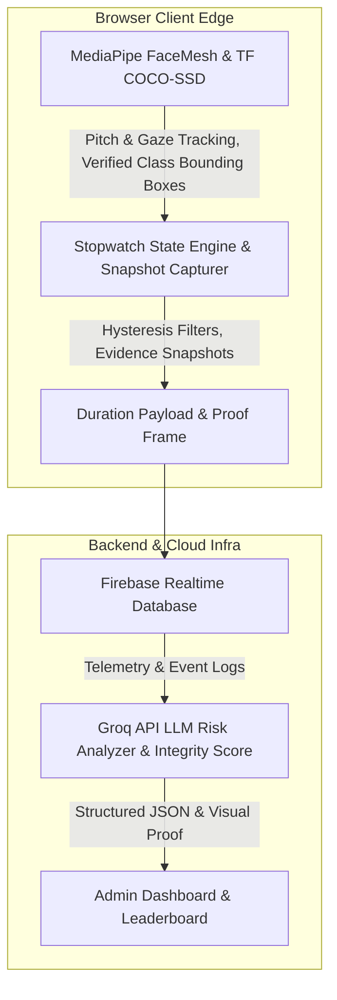

# AeroSoc BIT Mesra Proctored Testing Platform

**Author and Credits:** Anurag Kumar Verma

## 1. Purpose

The platform is built specifically for AeroSoc BIT Mesra's Recruitment Online Assessment. It addresses the need for a scalable, privacy-first testing environment that prevents cheating without using intrusive, instant-lockout mechanics. By employing an observe-and-log duration-based model, it ensures a seamless experience for candidates and zero media storage, while giving administrators concrete data on academic integrity.

## 2. Architecture Overview

**Core Framework:** Next.js 16 (App Router).

**Authentication and State:** Firebase Realtime Database and Admin SDK. (Note: Firestore is not used in order to avoid document write limits).

**Edge Proctoring Engine:** MediaPipe (FaceMesh for face presence, TF COCO-SSD for verified device detection). All processing executes client-side to minimize infrastructure costs.

**Data Flow:** Local stopwatch logging computes the exact duration of an infraction (e.g., out of fullscreen, verified device detected) and sends debounced writes to Firebase Realtime Database with lightweight evidence frames.

**Integrity & AI Analytics:** An objective mathematical Integrity Index (0–100%) combined with Groq API LLM risk evaluation produces human-readable, auditable proctoring summaries with snapshot proof for administrators.

### Architecture Flowchart

## 3. High-Concurrency Resilience and Scalability

The platform is engineered specifically to handle the Thundering Herd scenario, where 500 or more users click "Start Test" at the exact same millisecond. Traditional architectures fail under this stress due to database connection limits and strict API rate limiting. This platform guarantees stability for 500+ concurrent users processing 100+ MCQs through a four-pillar distributed architecture.

### 3.1 Overcoming Firebase Realtime Database Limitations

**The Workaround:** 
1. **Zero-Connection Exam State:** The system strictly prohibits the client application from maintaining an open WebSocket connection to Firebase during the examination.
2. **Offline-Resilient Persistence:** A custom `useTestState` hook tightly couples the React application state to the browser's `localStorage`. Every time a student selects one of the 100+ MCQs, the answer is synchronously updated on their local machine. This results in exactly zero database writes during the exam phase.

### 3.2 Overcoming Vercel and Database Read Bottlenecks

**Edge-Cached Question Delivery:** Questions are relayed through a serverless route (`/api/get-test-questions`) rather than direct client-to-database calls. This route is configured with aggressive `Cache-Control` headers. When the first user requests the test, Vercel fetches the payload from Firebase and caches it globally across its Edge Network. The database experiences zero additional reads, neutralizing the traffic spike completely.

### 3.3 Overcoming Submission Bottlenecks

**Secure Serverless Relay with Isolated Writes:** The final JSON payload is dispatched to a secure Vercel API route (`/api/grade-test`). Each function validates the Firebase Auth ID token server-side and then executes a write to a mathematically isolated path (`submissions/{testId}/{uid}`) using the Firebase Admin SDK. Because the write paths are entirely isolated, there is zero database contention. 

### 3.4 Scalability of Concurrent Proctoring Logs

When closing infractions, the system uses the RTDB `push()` method (`push(ref(rtdb, flagPath()), flag)`). Firebase push IDs are mathematically guaranteed to be unique and chronologically sortable based on time, meaning thousands of candidates can write concurrently to the same `/flags` path without locking the database or overwriting each other.

Furthermore, massive MediaPipe FaceMesh WASM binary and model assets are not bundled locally but fetched dynamically via the global `jsdelivr.net` CDN at runtime to keep initial payload sizes small.

## 4. Computer Vision & Frame Pipeline Optimization

- **Memory Leak and WebGL Context Loss Prevention:** The pipeline throttles AI inference to approximately 12 FPS by strictly enforcing a time delta (`now - lastFrameTime >= 83` ms) inside the `requestAnimationFrame` loop. It utilizes a `processing` boolean flag lock to prevent overlapping async inference calls. If MediaPipe throws an error, the `try-catch` block catches and suppresses it, keeping the React lifecycle alive.
- **Verified Device Detection without False Positives:** Phone detection relies strictly on verified deep learning models (COCO-SSD with MobileNet v2) using high confidence thresholds ($\ge 0.52$). Heuristic edge/rectangle detectors that falsely trigger on window frames, posters, and books have been eliminated.
- **Low-Tier Hardware Optimization:** On mobile platforms or hardware with low concurrency ($\le 4$ cores), heavy background models are skipped or lightweight backends (WASM/CPU) are gracefully initialized to prevent device freezing and battery drain.

## 5. Telemetry & State Synchronization

- **Tab Closure Protection:** A `flushInfractions` function is bound to the `beforeunload` event. It calculates the duration of active infractions from `startTime` to `Date.now()`, filters out brief anomalies, and synchronously executes Firebase `push()` commands to ensure logs make it to the RTDB before the tab finishes closing.
- **Dual-Counter Hysteresis Filters:** Infractions are tracked using a hysteresis filter requiring **16 consecutive violating frames** to open an infraction and **18 consecutive clean frames** to clear it. Clean frames decay the violation counter, preventing micro-stutters from flooding the database.
- **Visual Evidence Snapshot:** For critical violations (`MULTIPLE_FACES`, `PHONE_DETECTED`, `CAMERA_COVERED`), an ultra-lightweight client-side thumbnail ($320 \times 240$ JPEG, $\sim 8\text{ KB}$) is generated and attached to the flag. Evaluators can review this visual proof in the admin console.

## 6. Security and Integrity Mechanisms

The system enforces a strict defense-in-depth security perimeter:

- **Firebase Rules RBAC:** The `.validate` rule on the database strictly ensures that `Question Setters` can only edit and submit keys for records where `newData.child('authorEmail').val() == auth.token.email`.
- **Client-Side DOM Restrictions:** Rigorous DOM restrictions disable text selection, drag-to-copy, and context menus. Keydown listeners block keyboard shortcuts (Ctrl/Cmd + C, A, S, P, U), and `window.print` is actively overridden to defeat PDF exports.
- **Penalty HUD & DevTools Mitigation:** Getting to DevTools typically requires exiting fullscreen or unfocusing the window. Doing so triggers a `LEFT_FULLSCREEN` or `TAB_SWITCHED` infraction, logging a hard violation, deducting a Life, and putting the user in a 5-second mandatory blurred Penalty Box.
- **Time Tampering Defenses:** If an examinee tampers with the local clock to gain extra time, server-side timestamp validation during submission catches the drift, permanently stamping the submission with a `DELAYED_SUBMISSION` flag.

## 7. AI Risk Analysis & Objective Integrity Scoring

- **Mathematical Integrity Index:** The platform computes an objective score from 0% to 100% based on categorized infractions:
  - **Hard Violations** (Tab Switch, Fullscreen Exit, Multiple Faces, Unauthorized Device, Camera Obstructed): High point deductions.
  - **Soft Telemetry** (Gaze deviations, Natural head pitch while reading, Room noise): Gradual duration-based weighting ($1\text{ pt}$ per $20\text{ seconds}$ of cumulative deviation, max $25\text{ pts}$).
  - **Trust Ratings:** $\ge 85\%$ (High Trust), $65\%\text{--}84\%$ (Review Suggested), $< 65\%$ (Flagged).
- **Categorized Groq LLM Ingestion:** The Groq API receives separate summaries of hard violations vs soft physiological movements along with the calculated Integrity Score. This ensures fair, balanced proctoring summaries rather than blanket disqualifications.
- **Fallback & Rate Limits:** Rate limit errors (429) cleanly bubble to the admin UI with retry countdowns. If JSON parsing fails, the system safely falls back to standard calculated integrity metrics.

## 8. Role-Based Access Control and Security Architecture

The platform features a multi-tiered Role-Based Access Control system for delegating exam responsibilities securely.

**Personnel Request Flow:** Users authenticate via Google Auth to apply for roles such as Question Setter or Spectator. The Firebase Realtime Database rules strictly validate the email payload. 

**Question Setter Module:** Approved Question Setters create exam sections and upload questions stamped with a unique 9-character alphanumeric tag and bound to their email. Database rules strictly prevent cross-author tampering.

**Strict Results Declaration and Merge Engine:** The administrative "Declare Results" function implements an unyielding validation check blocking result computation if any Question Setter fails to upload a valid solution for their authored question.

## 9. Precision Proctoring & Candidate Protection

- **Separation of Hard Violations vs Soft Telemetry:** Natural actions like glancing down at rough paper, blinking, or screen corner reading (`HEAD_PITCH_DOWN`, `GAZE_AWAY`) are logged silently for review but **do not deduct student lives** or disrupt their exam.
- **Realistic Head Pitch Angles:** Forward screen viewing is recognized as normal posture. Lap-looking detection is calibrated to steep downward angles ($\text{headPitch} < -28^\circ$ AND $\text{pitchDeg} > 12^\circ$), preventing normal reading from triggering false alerts.
- **Adaptive Ambient Audio:** Background noise baseline updates dynamically to accommodate room fans and air conditioning, requiring human vocal frequencies ($300\text{--}3000\text{ Hz}$) before triggering audio warnings.
- **Evidence-Backed Admin Review:** When reviewing the leaderboard, administrators can click "View Proof" on any flagged incident to inspect the captured webcam snapshot. This eliminates guesswork and protects honest candidates.

## 10. Deployment and Usage

- **Deployed Application:** https://proctored-testing.vercel.app
- **Candidate Workflow:** Candidates authenticate with approved Google accounts, pass hardware calibration checks, and take the exam in fullscreen.
- **Administrator Workflow:** Administrators monitor active submissions, declare results with automated solution merging, inspect visual snapshot proof, and review AI integrity reports.
