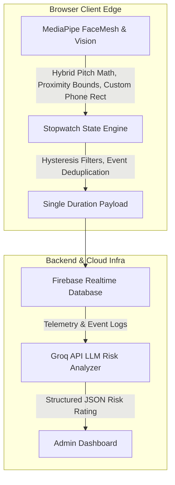

# AeroSoc BIT Mesra Proctored Testing Platform

**Author and Credits:** Anurag Kumar Verma

## 1. Purpose

The platform is built specifically for AeroSoc BIT Mesra's Recruitment Online Assessment. It addresses the need for a scalable, privacy-first testing environment that prevents cheating without using intrusive, instant-lockout mechanics. By employing an observe-and-log duration-based model, it ensures a seamless experience for candidates and zero media storage, while giving administrators concrete data on academic integrity.

## 2. Architecture Overview

**Core Framework:** Next.js 16 (App Router).

**Authentication and State:** Firebase Realtime Database and Admin SDK. (Note: Firestore is not used in order to avoid document write limits).

**Edge Proctoring Engine:** MediaPipe (FaceMesh for face presence, Vision Tasks for cell phone detection). All processing executes strictly on the client-side browser to guarantee zero audio or video storage.

**Data Flow:** Local stopwatch logging computes the exact duration of an infraction (e.g., out of fullscreen, phone detected) and sends a single debounced write to Firebase Realtime Database upon completion.

**AI Analytics:** Groq API ingests the duration-based logs to generate a final, human-readable proctoring summary for the administrative dashboard.

### Architecture Flowchart

## 3. High-Concurrency Resilience and Scalability

The platform is engineered specifically to handle the Thundering Herd scenario, where 500 or more users click "Start Test" at the exact same millisecond. Traditional architectures fail under this stress due to database connection limits and strict API rate limiting. This platform guarantees stability for 500+ concurrent users processing 100+ MCQs through a four-pillar distributed architecture.

### 3.1 Overcoming Firebase Realtime Database Limitations

**The Workaround:** 
1. **Zero-Connection Exam State:** The system strictly prohibits the client application from maintaining an open WebSocket connection to Firebase during the examination.
2. **Offline-Resilient Persistence:** A custom `useTestState` hook tightly couples the React application state to the browser's `localStorage`. Every time a student selects one of the 100+ MCQs, the answer is synchronously updated on their local machine. This results in exactly zero database writes during the exam phase.

### 3.2 Overcoming Vercel and Database Read Bottlenecks

**Edge-Cached Question Delivery:** Questions are relayed through a serverless route (`/api/get-test-questions`) rather than direct client-to-database calls. This route is configured with aggressive `Cache-Control` headers. When the first user requests the test, Vercel fetches the payload from Firebase and caches it globally across its Edge Network. The database experiences zero additional reads, neutralizing the traffic spike completely.

### 3.3 Overcoming Submission Bottlenecks

**Secure Serverless Relay with Isolated Writes:** The final JSON payload is dispatched to a secure Vercel API route (`/api/grade-test`). Each function validates the Firebase Auth ID token server-side and then executes a write to a mathematically isolated path (`submissions/{testId}/{uid}`) using the Firebase Admin SDK. Because the write paths are entirely isolated, there is zero database contention. 

### 3.4 Scalability of Concurrent Proctoring Logs

When closing infractions, the system uses the RTDB `push()` method (`push(ref(rtdb, flagPath()), flag)`). Firebase push IDs are mathematically guaranteed to be unique and chronologically sortable based on time, meaning thousands of candidates can write concurrently to the same `/flags` path without locking the database or overwriting each other.

Furthermore, massive MediaPipe FaceMesh WASM binary and model assets are not bundled locally but fetched dynamically via the global `jsdelivr.net` CDN at runtime to keep initial payload sizes small.

## 4. Computer Vision & Frame Pipeline Optimization

- **Memory Leak and WebGL Context Loss Prevention:** The pipeline throttles AI inference to approximately 12 FPS by strictly enforcing a time delta (`now - lastFrameTime >= 83` ms) inside the `requestAnimationFrame` loop. It utilizes a `processing` boolean flag lock to prevent overlapping async inference calls. If MediaPipe throws an error, the `try-catch` block catches and suppresses it, keeping the React lifecycle alive.
- **Low-Tier Hardware Optimization:** The system checks if the device is a mobile platform or has low CPU cores (`navigator.hardwareConcurrency <= 4`). If the hardware is deemed low-end, the system skips loading the heavy TensorFlow `COCO-SSD` model entirely. Instead, it relies solely on a custom, highly optimized, non-ML rectangle detector (`detectRectangle`) that uses Sobel edge detection and pixel projection to find phone-like bounding boxes every 600ms.

## 5. Telemetry & State Synchronization

- **Tab Closure Protection:** A `flushInfractions` function is bound to the `beforeunload` event. It calculates the duration of active infractions from `startTime` to `Date.now()`, filters out brief anomalies, and synchronously executes Firebase `push()` commands to ensure logs make it to the RTDB before the tab finishes closing.
- **Debounce and Hysteresis Thresholds:** Infractions are tracked using a dual-counter hysteresis filter. It takes **14 consecutive violating frames** to open an infraction and **20 consecutive clean frames** to clear it. Clean frames decay the violation counter by 2, heavily debouncing micro-stutters and requiring sustained correct posture to clear violations.

## 6. Security and Integrity Mechanisms

The system enforces a strict defense-in-depth security perimeter:

- **Firebase Rules RBAC:** The `.validate` rule on the database strictly ensures that `Question Setters` can only edit and submit keys for records where `newData.child('authorEmail').val() == auth.token.email`.
- **Client-Side DOM Restrictions:** Rigorous DOM restrictions disable text selection, drag-to-copy, and context menus. Keydown listeners block keyboard shortcuts (Ctrl/Cmd + C, A, S, P, U), and `window.print` is actively overridden to defeat PDF exports.
- **Penalty HUD & DevTools Mitigation:** While advanced users might try to use DevTools to override visual CSS blurs or React state, getting to DevTools typically requires exiting fullscreen. Doing so triggers a `LEFT_FULLSCREEN` infraction, instantly logging a critical violation, deducting a "Life", and putting the user in a 5-second mandatory blurred Penalty Box. 
- **Time Tampering Defenses:** If an examinee tampers with the local clock heavily to give themselves infinite time, the server-side timestamp validation during submission catches the drift, permanently flagging it with a `DELAYED_SUBMISSION` integrity flag. Additionally, admins can force a client state wipe via a `resetAt` database flag.

## 7. AI Risk Analysis

- **Token Limits:** Before sending the prompt to the Groq LLM, the backend iterates over the raw array of `DurationFlag` objects and structurally aggregates them into a `durationSummary` hash map of total durations by event type. This condensed summary completely bypasses LLM token limits regardless of how many individual logs fired.
- **Composite Violations Penalty:** The LLM prompt explicitly instructs that 0-15 total flags are benign background noise ('low'), 16-40 is 'medium', and 41+ is 'high'. However, a hardcoded override dictates that **ANY duration** of `PHONE_DETECTED` or `MULTIPLE_FACES` represents a critical cheating event and mandates an immediate 'high' severity risk rating.
- **Fallback & Rate Limits:** If the LLM returns malformed JSON or reasoning traces (e.g., `<think>`), a regex cleans the payload and extracts the JSON block. If parsing still fails, it gracefully falls back to `{ severity: 'low', summary: 'Analysis complete.' }`. Rate limits (429) correctly parse the wait time and pipe the error back to the client.

## 8. Role-Based Access Control and Security Architecture

The platform features a multi-tiered Role-Based Access Control system for delegating exam responsibilities securely.

**Personnel Request Flow:** Users authenticate via Google Auth to apply for roles such as Question Setter or Spectator. The Firebase Realtime Database rules strictly validate the email payload. 

**Question Setter Module:** Approved Question Setters create exam sections and upload questions stamped with a mathematically unique 9-character alphanumeric tag and bound to their email. Database rules strictly prevent cross-author tampering.

**Strict Results Declaration and Merge Engine:** The administrative "Declare Results" function implements an unyielding validation check blocking result computation if any Question Setter fails to upload a valid solution for their authored question.

## 9. Precision Proctoring and Edge Case Management

**Non-Disruptive Face Tracking:** Traditional proctoring tools actively disrupt examinations for minor infractions, causing extreme candidate anxiety. This platform re-engineers face tracking algorithms (`HEAD_PITCH_DOWN`, `DUCKING_DOWN`, `NO_FACE`) to operate as a silent telemetry engine. When a student looks at their lap or drops out of frame, the system deducts a life from the persistent gamified HUD and instantly logs a critical severity flag to the Firebase backend for administrative review. It deliberately suppresses all client-side popup notifications and screen locks, allowing the test to continue completely uninterrupted.

**Targeted Alignment HUD:** Conversely, gross postural misalignments (`SHOULDERS_OUT_OF_FRAME`) trigger an exclusive, non-punitive "Camera Alignment Required" overlay. This HUD blurs the exam and projects a live webcam feed with a geometric target frame, forcing the student to physically adjust their hardware. Once the skeletal landmarks satisfy the mathematical boundaries, the overlay instantly dissolves with zero penalty applied.

## 10. Deployment and Usage

**Deployed Application:** https://proctored-testing.vercel.app

**Candidate Workflow:** Candidates authenticate exclusively via pre-approved Google accounts. After granting hardware permissions and passing local environmental checks, the interface enforces a fullscreen constraint. Answers are cached locally in real-time to survive network drops. Upon completion or timer expiration, the answers are securely relayed to the server.

**Administrator Workflow:** Authorized administrators access a secure dashboard to monitor active test takers, review telemetry data, and analyze human-readable proctoring reports generated by the Groq AI integration.
